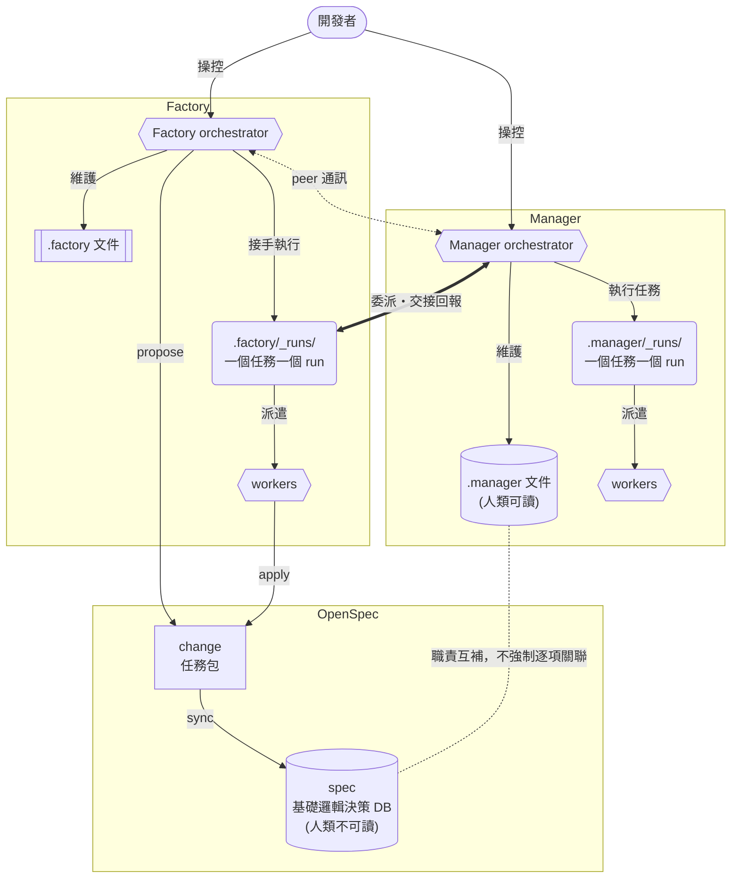
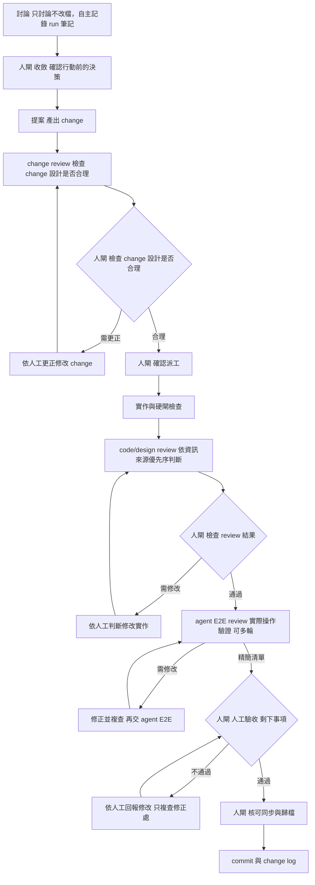
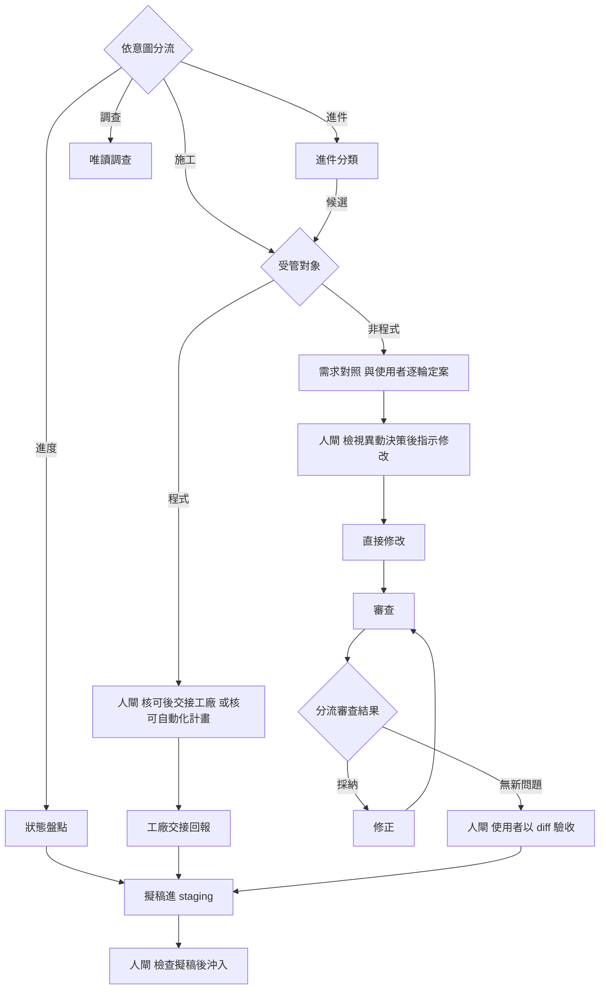
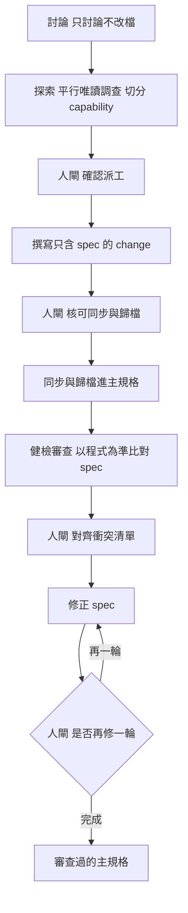

# .agents

## 文件導覽

| 文件 | 內容 |
| --- | --- |
| [orchestrator-factory-readme.md](./orchestrator-factory-readme.md) | 工廠模式的流程、工作區與規則說明 |
| [orchestrator-pm-readme.md](./orchestrator-pm-readme.md) | PM 模式的流程、工作區與規則說明 |
| [init-agent-script/readme.md](./init-agent-script/readme.md) | 建立各工具捷徑的初始化步驟 |

<details>
<summary>目錄</summary>

- [關於本專案](#關於本專案)
- [技術堆疊](#技術堆疊)
- [快速開始](#快速開始)
- [專案結構](#專案結構)
- [專案邏輯](#專案邏輯)
- [Skill 一覽](#skill-一覽)

</details>

## 關於本專案

這是我個人開發與研究用的 agent skill 組合，在 Cursor、Claude Code、Codex 等工具之間共用。內容一半是自己依實際工作整理出來的流程與寫作規範，一半是第三方的 skill 與架構，例如 OpenSpec 的規格驅動流程、Matt Pocock 的工程方法、Vue 與 Regle 的框架實務；第三方 skill 有些維持原樣，有些依我的工作方式改寫過。核心是兩套指揮流程：工廠模式負責一項開發從討論到歸檔的主線，PM 模式負責專案方向、進度盤點與交接。這個 skill 組合本身也用 PM 模式管理，改善的決策與每個 skill 的元素對照記錄在本目錄的管理資料夾。

## 技術堆疊

| 類型 | 名稱 | 說明 |
| --- | --- | --- |
| 規格驅動流程 | [OpenSpec](https://github.com/Fission-AI/OpenSpec) | propose、apply、sync、archive 等原生 skill 與指令 |
| Agent 技能標準 | Agent Skills | 每個 skill 是一個資料夾，主檔為 `SKILL.md` |
| Agent 工具 | Cursor、Claude Code | 以初始化腳本建立指向本目錄的捷徑 |
| Agent 工具 | Codex | 讀取各 skill 的 `agents/openai.yaml` 調用設定 |

## 快速開始

初始化步驟見 [init-agent-script/readme.md](./init-agent-script/readme.md)。依使用的工具執行對應腳本一次即可。

## 專案結構

```text
.agents/
├── skills/                          # 全部 skill，每個 skill 一個資料夾
├── commands/                        # OpenSpec 相關斜線指令
├── init-agent-script/               # 建立各工具捷徑的腳本
├── .manager/                        # 管理本 skill 組合的決策、進度與元素對照
├── orchestrator-factory-readme.md   # 工廠模式說明
└── orchestrator-pm-readme.md        # PM 模式說明
```

## 專案邏輯

共有三種指揮者。PM 模式與反向規格只在使用者明確啟用時進入；工廠模式另可在新 session 接手已建立的交接時進入，進入後所有人閘照樣生效。使用者核可的自動化計畫會調整人閘位置：檢視 change 與人工 E2E 各合併成整批一次，省去逐 run 的派工確認，每個 run 預設 commit 一次，push 仍要另外授權。



### 工廠模式

由 `orchestrator-factory` 調度，走一項開發的主線。每個人閘都停下等使用者，自動化時依上述方式合併；檢查通過不等於可以出貨。



### PM 模式

由 `orchestrator-pm` 調度，管專案方向與狀態。產品是程式時，實作交給工廠；使用者核可自動化計畫時，manager 經 peer 協調同一個工廠 session，先讓所有 run 完成提案與 change review，整批檢視後再依相依順序施工。受管對象是 skill 或文件等非程式內容時，走非產品路線，由 manager 先做需求對照、寫異動決策，再直接修改並審查；需求對照與審查是預設步驟。正典狀態的更新除初始化外一律先擬稿，使用者檢查後才沖入。



### 反向規格

由 `orchestrator-reverse-spec` 調度，替未導入 OpenSpec 的既有專案反寫主規格，流程止於審查過的規格，不改動產品程式。從決策到程式，每往下一層都會流失資訊，程式只留下行為，留不下理由。因此反向規格只能推回 opsx spec，推不回 `.manager` 記錄的決策脈絡。這些脈絡只能在開發過程中累積，一旦錯過就無法補回。



## Skill 一覽

欄位：skill 名稱、作者、是否自動啟用、簡述。作者來自公開倉庫時附上 GitHub 連結，依我的工作方式改寫過的另外註明。自動啟用為「是」表示 agent 可自行判斷載入，「否」表示只能由使用者手動呼叫。

### 工廠流程

依工廠實際流程排序；末兩項為選配的提案審查組合，也可單獨使用。

| 順序 | Skill | 作者 | 自動啟用 | 簡述 |
| --- | --- | --- | --- | --- |
| 1 | `orchestrator-factory` | 自製 | 是 | 工廠模式總指揮：排程、派工、人閘、審查結果判斷、agent E2E 覆核與跨 run 驗收清單 |
| 2 | `discuss-first` | 自製 | 是 | 只討論不改檔的開場，只答所問 |
| 3 | `openspec-propose` | [OpenSpec](https://github.com/Fission-AI/OpenSpec) | 是 | 一次產出 change 的提案、設計與任務清單 |
| 4 | `opsx-propose-guide` | 自製 | 是 | 提案規範：切分、命名、依賴、驗證骨架安全與修訂標註 |
| 5 | `test-first` | 自製 | 是 | 測試優先，提案階段必載，實作階段沿用 |
| 6 | `openspec-apply-change` | [OpenSpec](https://github.com/Fission-AI/OpenSpec) | 是 | 依 change 任務逐項實作 |
| 7 | `opsx-apply-guide` | 自製 | 是 | 實作規範：逐項勾選、測試調整紀律、修訂輪與人工驗證清單 |
| 8 | `hard-verify` | 自製 | 是 | 執行編譯、建置、靜態檢查與單元測試等硬閘 |
| 9 | `code-review` | 改寫自 [Matt Pocock](https://github.com/mattpocock/skills) | 是 | 規範與規格雙軸審查，依資訊來源優先序判斷並標註問題分類 |
| 10 | `e2e-review` | 自製 | 是 | 人工驗收前的 agent 自檢：依清單操作系統畫面或 API、準備測試資料、取證並交報告，腳本與 recipes 累積在專案的 `.e2e/` |
| 11 | `openspec-sync-specs` | [OpenSpec](https://github.com/Fission-AI/OpenSpec) | 是 | 將變更規格同步進主規格 |
| 12 | `openspec-archive-change` | [OpenSpec](https://github.com/Fission-AI/OpenSpec) | 是 | 完成後歸檔 change |
| 13 | `commit-message-suggestion` | 自製 | 是 | 產生 commit 訊息建議，使用者明確要求或核可的自動化計畫指定時可代為提交，不含 push |
| 14 | `change-log` | 自製 | 是 | 產出改動清單，向使用者與開發者說明變更 |
| 選配 | `change-review-request` | 自製 | 是 | 撰寫提案審查邀請，列出決策脈絡來源 |
| 選配 | `change-review-response` | 自製 | 是 | 回覆提案審查，寫出結論、疑慮分類與下一步 |

### PM 流程

| Skill | 作者 | 自動啟用 | 簡述 |
| --- | --- | --- | --- |
| `orchestrator-pm` | 自製 | 否 | PM 模式總指揮：專案方向、進度與交接；非程式內容可走非產品路線直接修改 |
| `pm-intake-triage` | 自製 | 是 | 進件分類與整併，候選工作標註交工廠或非產品路線 |
| `pm-investigation-worker` | 自製 | 是 | 唯讀調查工作者，依派工產出指定的發現檔，也可拆解文件或規則 |
| `pm-status-review` | 自製 | 是 | 證據式狀態盤點，篩選工廠留給 manager 的交接檔並擬待沖入稿 |
| `pm-factory-handoff` | 自製 | 是 | 人閘核可後建立自足的工廠交接，自動化計畫下可一次建立多個 |

### 協作與判斷

| Skill | 作者 | 自動啟用 | 簡述 |
| --- | --- | --- | --- |
| `need-ask-user-guide` | 自製 | 是 | 委派工作中判斷是否詢問使用者，規範檢查點的待決與提醒呈現 |
| `peer-agent-coordination` | 自製 | 是 | 多 agent 共用工作區的協調協定；不主動啟用，使用者提及、協作討論需要，或使用者核可的流程（如 manager 委派）指定時才用，沒有即時通道時由使用者人工轉送 |
| `orchestrator-helper` | 自製 | 是 | 輔助指揮者：依工作當下的契約接手任何工作，持有自己的簡單脈絡；使用者，或經授權的 manager、factory 可發動 |
| `decision-support` | 自製 | 是 | 把糾纏的決策拆成獨立節點，逐節點權衡與推薦 |
| `explain` | 自製 | 是 | 把目標拆成摘要與元素清單 |

### 文件寫作

| Skill | 作者 | 自動啟用 | 簡述 |
| --- | --- | --- | --- |
| `doc-general-guide` | 自製 | 是 | 文件寫作父層規範與類型路由，直接負責工程參考手冊與盤點清單 |
| `doc-readme-guide` | 自製 | 是 | 私有或小團隊 README；繼承 `doc-general-guide` |
| `doc-sop-guide` | 自製 | 是 | 熟悉環境者的 SOP 與 runbook；繼承 `doc-general-guide` |
| `doc-tutorial-guide` | 自製 | 是 | 第一次操作者照做的部署、設定與接手教學；繼承 `doc-general-guide` |
| `doc-user-guide` | 自製 | 是 | 應用程式畫面的使用者操作手冊；繼承 `doc-general-guide` |
| `doc-openapi-guide` | 自製 | 是 | OpenAPI 文件與文件類程式碼實作指引；繼承 `doc-general-guide` |
| `code-to-docs` | 自製 | 否 | 依程式與主規格產出人類可讀文件 |

### 其他選配

| Skill | 作者 | 自動啟用 | 簡述 |
| --- | --- | --- | --- |
| `orchestrator-reverse-spec` | 自製 | 否 | 反寫既有專案為 OpenSpec 主規格的指揮者 |
| `openspec-explore` | [OpenSpec](https://github.com/Fission-AI/OpenSpec) | 是 | 探索模式：釐清想法，尚未開立 change |
| `opsx-health-check` | 自製 | 否 | 主規格與程式落差的健康檢查，匯出比對報告 |
| `impl-verify` | 自製 | 是 | 需求邊界檢查；可獨立使用，非工廠主路徑 |
| `playwright-cli` | [Microsoft](https://github.com/microsoft/playwright-cli) | 是 | 瀏覽器命令列自動化；`impl-verify` 的依賴 |
| `create-skill-guide` | 自製 | 是 | 建立或更新 skill 時的檔頭、調用設定與版本規範 |
| `thought-palette-extract` | 自製 | 是 | 收斂決策為可匯入圖像化工具的結構化資料 |
| `dab-sidecar-guide` | 自製 | 是 | 查詢或實作資料庫相關功能時，參考 DAB sidecar 補充資訊 |
| `karpathy-guidelines` | [forrestchang/andrej-karpathy-skills](https://github.com/forrestchang/andrej-karpathy-skills) | 是 | 實作行為準則：先想清楚、簡化、外科手術式改動 |
| `ponytail` | [DietrichGebert](https://github.com/DietrichGebert/ponytail) | 是 | 懶惰資深工程師模式：選最簡可行解 |
| `i-have-adhd` | [ayghri](https://github.com/ayghri/i-have-adhd) | 否 | ADHD 友善輸出：先給下一步、步驟編號、跨回合重述狀態 |
| `grill-me` | [Matt Pocock](https://github.com/mattpocock/skills) | 否 | 以連續拷問對齊計畫與設計 |
| `grill-with-docs` | [Matt Pocock](https://github.com/mattpocock/skills) | 否 | 拷問並同步產出決策紀錄與詞彙表 |
| `grilling` | [Matt Pocock](https://github.com/mattpocock/skills) | 是 | grill 系列底層可複用迴圈 |
| `codebase-design` | [Matt Pocock](https://github.com/mattpocock/skills) | 是 | 深度模組設計的共用詞彙與紀律 |
| `domain-modeling` | [Matt Pocock](https://github.com/mattpocock/skills) | 是 | 打磨專案領域模型與共用語言 |
| `diagnosing-bugs` | [Matt Pocock](https://github.com/mattpocock/skills) | 是 | 難除缺陷與效能回歸的診斷迴圈 |
| `improve-codebase-architecture` | [Matt Pocock](https://github.com/mattpocock/skills) | 否 | 掃描架構加深機會，再以拷問收斂 |
| `prototype` | [Matt Pocock](https://github.com/mattpocock/skills) | 是 | 用拋棄式原型回答設計問題 |
| `research` | [Matt Pocock](https://github.com/mattpocock/skills) | 是 | 依高信任來源調查並寫成 Markdown |
| `resolving-merge-conflicts` | [Matt Pocock](https://github.com/mattpocock/skills) | 是 | 進行中的合併或變基衝突逐塊解決 |
| `triage` | [Matt Pocock](https://github.com/mattpocock/skills) | 否 | 議題與外部合併請求的分流狀態機 |
| `wayfinder` | [Matt Pocock](https://github.com/mattpocock/skills) | 否 | 超長程工作的決策票地圖 |
| `handoff` | [Matt Pocock](https://github.com/mattpocock/skills) | 否 | 壓縮對話成交接文件給下一個 agent |
| `teach` | [Matt Pocock](https://github.com/mattpocock/skills) | 是 | 以工作區為狀態的多回合教學 |
| `writing-great-skills` | [Matt Pocock](https://github.com/mattpocock/skills) | 否 | 編寫與編輯 skill 的詞彙與原則 |
| `vue-best-practices` | [vuejs-ai](https://github.com/vuejs-ai/skills) | 是 | Vue 3 Composition API 與 TypeScript 實務 |
| `vue-pinia-best-practices` | [vuejs-ai](https://github.com/vuejs-ai/skills) | 是 | Pinia 狀態管理與反應性模式 |
| `vue-router-best-practices` | [vuejs-ai](https://github.com/vuejs-ai/skills) | 是 | Vue Router 導航守衛與生命週期 |
| `vue-testing-best-practices` | [vuejs-ai](https://github.com/vuejs-ai/skills) | 是 | Vitest、元件測試與端對端測試實務 |
| `regle` | [Victor Garcia](https://github.com/victorgarciaesgi/regle) | 是 | Regle 表單驗證核心 |
| `regle-rules` | [Victor Garcia](https://github.com/victorgarciaesgi/regle) | 是 | 內建與自訂驗證規則 |
| `regle-advanced` | [Victor Garcia](https://github.com/victorgarciaesgi/regle) | 是 | 集合、非同步與跨元件等進階模式 |
| `regle-schemas` | [Victor Garcia](https://github.com/victorgarciaesgi/regle) | 是 | 與 Zod、Valibot 等 schema 庫整合 |
| `regle-typescript` | [Victor Garcia](https://github.com/victorgarciaesgi/regle) | 是 | Regle 的 TypeScript 型別整合 |
| `regle-migrate-vuelidate` | [Victor Garcia](https://github.com/victorgarciaesgi/regle) | 是 | 自 Vuelidate 遷移至 Regle |
